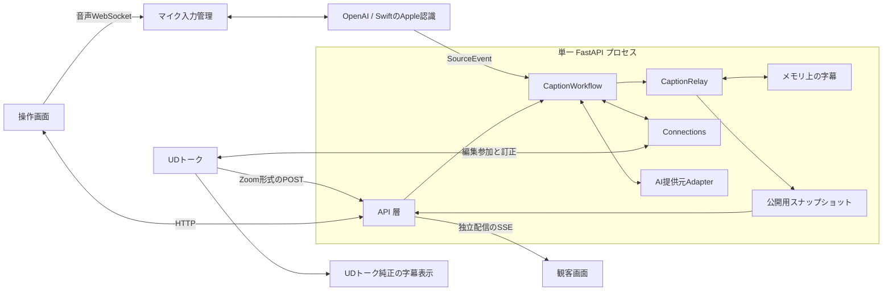

# システム構成

実装確認日：2026-10-11

Caption Relay は、単一の FastAPI プロセスが字幕の状態を持つローカル PoC。React の操作画面は HTTP で取得・更新し、観客画面は SSE で公開字幕を受け取る。現在の振る舞いは[現行 PoC の仕様](docs/current-behavior.md)、起動方法は[開発手順](docs/development.md)を参照する。

## 実装の入口

| 場所 | 責務 |
|---|---|
| [backend/app/main.py](backend/app/main.py) | HTTP ルート、エラー応答、SSE、ビルド済み画面の配信 |
| [backend/app/relay.py](backend/app/relay.py) | セッション状態、入力の改版・再送判定、手修正、公開可否、購読キュー |
| [backend/app/workflow.py](backend/app/workflow.py) | 入力、AI処理の開始・取消、訂正先への送信、保存時の改版照合 |
| [backend/app/connections.py](backend/app/connections.py) | 接続モードと入力の開始・終了、接続変更と保存の直列化 |
| [backend/app/transcription/](backend/app/transcription/) | ブラウザ音声の単一接続、周波数変換、提供元の認識結果と累積試験使用量 |
| [native/speech-helper.swift](native/speech-helper.swift) | SpeechAnalyzerを呼ぶSwift子プロセス。標準入力の音声と標準出力の認識結果 |
| [backend/app/zoom_input.py](backend/app/zoom_input.py) | Zoom形式のUTF-8字幕、明示的に選んだ名前付き形式の分離、送信番号、同一発話の訂正・取消、受信先の資格情報 |
| [backend/app/udtalk_editor.py](backend/app/udtalk_editor.py) | 編集用URLの権限・期限、純正編集通信の参加・受信・ロック・訂正・解除 |
| [backend/app/udtalk.py](backend/app/udtalk.py)・[udtalk_web.py](backend/app/udtalk_web.py) | UDトークWeb表示の実験用入力Adapter、断片・再送・途中／確定の変換、取得と終了処理 |
| [backend/app/ai.py](backend/app/ai.py)・[ai_provider.py](backend/app/ai_provider.py) | AI候補・料金・キーの有無、振り分け、応答時間の集計、提供元へのHTTP要求と完了結果の検証 |
| [backend/app/dictionary.py](backend/app/dictionary.py) | 単語辞書の改版、ローカルファイル保存、認識・AI要求ごとの辞書の取得 |
| [backend/app/models.py](backend/app/models.py) | 入力・応答・内部状態・公開字幕の Pydantic モデル |
| [frontend/src/roots.tsx](frontend/src/roots.tsx) | 各画面の Root、XState actor と Presenter の接続 |
| [frontend/src/views/](frontend/src/views/) | 描画と操作イベントの通知 |
| [frontend/src/events/](frontend/src/events/) | 親子関係とイベント伝播 |
| [frontend/src/adapters/microphone.ts](frontend/src/adapters/microphone.ts) | マイク権限、AudioWorkletによるPCM化、音声WebSocket、録音資源の解放 |
| [frontend/src/adapters/fullscreen.ts](frontend/src/adapters/fullscreen.ts) | 全画面のブラウザ API と変更通知 |
| [frontend/src/machines/](frontend/src/machines/) | 操作の可否、状態遷移、副作用を裁定する Mediator |
| [frontend/src/presenters/](frontend/src/presenters/) | 状態から描画パラメータへの変換 |
| [frontend/src/api.ts](frontend/src/api.ts) | HTTP・SSE の Adapter |
| [docs/generated/](docs/generated/) | 生成した OpenAPI と型生成の説明 |
| [scripts/](scripts/) | 依存関係の導入、起動、検証、OpenAPI の生成 |

## データの流れ

FastAPIはPydanticモデルで入出力を検証し、入力と訂正保存を `CaptionWorkflow` へ渡す。状態遷移と公開可否は `CaptionRelay`、外部接続の寿命と送信先は `Connections` が所有する。AI要求はバックグラウンドで実行し、元の発話の更新とモード変更で終了する。保存と接続変更は同時に実行しない。訂正先への送信前後に原文・表示文の改版を照合し、古い原文で新しい発話を上書きしない。存在しない字幕と改版競合はAPI層で404・409に変換する。

`create_app()`ごとに独立した字幕状態を作る。字幕状態を共有するデータベースはなく、再起動で消えるため、複数ワーカーで運用しない。字幕・接続・AI設定・測定結果をこのプロセスに保持する。各AI提供元のキーは環境変数で読み、画面へ返さない。通常起動では単語辞書とマイク認識の試験使用量を再起動をまたぐファイルに保存する。テスト用の `create_app()` は辞書を注入しない限りメモリ上に保持する。詳細は[単語辞書](docs/dictionary.md)を参照する。

接続の初期値は独立配信。Zoom形式の送信先はプロセス内で生成し、再起動と接続変更で更新する。従来のWeb入力Adapterは `CAPTION_RELAY_UDTALK_URL` を設定した場合に開始する。編集参加へ切り替えると両方の入力を止め、有効な編集用URLの参加を開始する。入力の変換は各Adapter、公開と手修正の判断はRelayが所有する。経路・根拠・制約は[UDトークの入力接続](docs/udtalk-input.md)を参照する。

編集参加では共有URLの権限と期限を変更せず、純正Windows版で観察した通信を使う。起動時のカーソル以降の発話を受信し、同じ発話IDで編集ロックを取得して確定訂正を送る。要求の受付と純正画面への表示を区別する。実機の訂正反映は障害復旧後の確認が必要なため、画面では試験接続として扱う。編集参加で受信した字幕は観客用の公開対象にしない。

`AiRouter` は指定AI・参考費用・受信した応答時間に基づいて選び、`CaptionRelay` が確定入力の改版に対する依頼IDとモデルを保存する。結果の依頼ID・モデル・入力改版が一致した場合だけ測定値とAI候補を採用する。設定の変更は既存の依頼を差し替えず、次の確定入力から使う。詳細は[AIの選択と振り分け](docs/ai-routing.md)を参照する。

マイク入力は独立配信だけで利用する。`Connections`が旧入力を停止してから設定を変え、`MicrophoneInput`が録音接続と認識Adapterの寿命を所有する。切断時の解放はASGIの取消から保護し、提供元接続とSwift子プロセスを閉じてから次の入力を許可する。OpenAIの発話区切りはWebRTC VAD、周波数変換はsoxr、途中と確定の対応は各認識Adapterが所有する。詳細は[マイク入力](docs/microphone-input.md)を参照する。

## API と公開データの境界

Zoom受信先の資格情報は操作画面用の接続状態だけに返す。編集用URLは適用時だけ送信し、応答・字幕ID・ログへ含めない。AIキーは提供元の認証ヘッダーで送り、画面には設定済みかどうかだけを返す。アクセスログはURLの資格情報を記録しないよう起動スクリプトで無効にする。アプリ全体の認証はなく、loopbackでのローカル利用を前提とする。

バックエンドは FastAPI と Pydantic v2 を使用する。入力・応答と内部の状態をモデルで型付けし、`backend/pyproject.toml` の pyright 厳格モードを通す。基底の `Model` は余分な項目と暗黙の型変換を拒否し、代入も検証する。

操作画面用の `Caption` と観客用の `PublicCaption` を分ける。`PublicSnapshot` は表示可否・表示設定・公開字幕、`PublicCaption` は字幕 ID・改版・表示文・発話者名を定義する。公開用モデルへ原文や入力側の管理情報を追加しない。操作画面用の全履歴は保持し、公開済みIDの索引から、スクロール方式では全件、直近の字幕では設定した件数を取り出す。順序は最初の入力の受信順で、古い発話を後から公開・訂正しても末尾へ移さない。

発話者名は本文とは別に保持し、公開時点の名前を `public_speaker` に残す。名前の非表示設定では公開スナップショットの名前もnullにする。AIと手動訂正は本文を更新し、名前を保持する。

`Caption.received_at` は、`CaptionRelay` が発話を初めて受信したときにUTCで記録する。後続の改版や編集では更新せず、操作画面のPresenterが端末のタイムゾーンに合わせて表示する。観客用の字幕には含めない。

SSE は購読登録と初期スナップショットの取得を中断なしに行い、以後も表示範囲の全体のスナップショットを送る。表示可否・表示設定・その範囲の字幕ID・本文・発話者名が同じ場合は通知を省く。同じ本文のまま改版番号だけが変わった場合、最新番号はGETと再接続時の初期スナップショットで返す。購読キューが満杯になったら古いスナップショットを破棄し、最新状態を送る。スクロール方式への切り替えや表示件数の増加では、保持している過去の公開文を含む状態を送り直す。永続イベントや再接続カーソルは持たない。

[API の型生成](docs/generated/README.md)でバックエンドのモデルから OpenAPI と TypeScript 型を生成する。フロントエンドの Adapter は生成した型を使用し、API モデルを独自に再定義しない。

## 画面の責務

画面と共有の Button・Textarea はそれぞれの Scope を持って Root の配下に置き、Passive View、Presenter、Mediator、Adapter に責務を分ける。親へ伝播する操作イベントと XState の状態遷移の詳細は[フロントエンドの構成](docs/frontend-architecture.md)を参照する。

## 境界の検証

- [backend/tests/test_api.py](backend/tests/test_api.py)：入力検証、改版競合、手修正の保護、公開データの分離、アプリごとの独立状態。
- [backend/tests/test_relay.py](backend/tests/test_relay.py)：返却値による内部状態の変更防止、受信時刻の保持、SSE スナップショット、満杯のキューの再同期。
- [backend/tests/test_zoom_input.py](backend/tests/test_zoom_input.py)・[test_ai_provider.py](backend/tests/test_ai_provider.py)・[test_udtalk_editor.py](backend/tests/test_udtalk_editor.py)：受信の再送・訂正・取消、提供元の要求・時間超過、編集権・ロック・原文競合・送信失敗・配信先の分離。外部の応答は模擬HTTPで検証する。
- [frontend/src/events/](frontend/src/events/)・[machines/](frontend/src/machines/)・[presenters/](frontend/src/presenters/) のテスト：イベント伝播、状態遷移、操作可否。
- [scripts/check.sh](scripts/check.sh)：生成契約の一致、フロントエンドのテスト・型検査・ビルド、バックエンドの型検査・テスト。

View が業務状態を持たないことなど、責務分離の一部はソースレビューで確認する。自動テストは実ブラウザと実 API を使った操作確認を代替しない。
