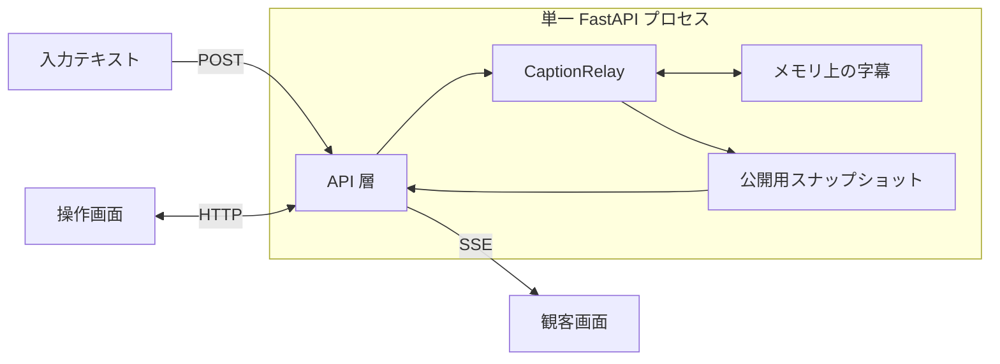

# システム構成

実装確認日：2026-10-06

Caption Relay は、単一の FastAPI プロセスが字幕の状態を持つローカル PoC。React の操作画面は HTTP で取得・更新し、観客画面は SSE で公開字幕を受け取る。現在の振る舞いは[現行 PoC の仕様](docs/current-behavior.md)、起動方法は[開発手順](docs/development.md)を参照する。

## 実装の入口

| 場所 | 責務 |
|---|---|
| [backend/app/main.py](backend/app/main.py) | HTTP ルート、エラー応答、SSE、ビルド済み画面の配信 |
| [backend/app/relay.py](backend/app/relay.py) | セッション状態、入力の改版・再送判定、手修正、公開可否、購読キュー |
| [backend/app/ai.py](backend/app/ai.py) | AI候補・料金、振り分け先、応答時間の集計。提供元への接続は後の段階で追加 |
| [backend/app/models.py](backend/app/models.py) | 入力・応答・内部状態・公開字幕の Pydantic モデル |
| [frontend/src/roots.tsx](frontend/src/roots.tsx) | 各画面の Root、XState actor と Presenter の接続 |
| [frontend/src/views/](frontend/src/views/) | 描画と操作イベントの通知 |
| [frontend/src/events/](frontend/src/events/) | 親子関係とイベント伝播 |
| [frontend/src/adapters/fullscreen.ts](frontend/src/adapters/fullscreen.ts) | 全画面のブラウザ API と変更通知 |
| [frontend/src/machines/](frontend/src/machines/) | 操作の可否、状態遷移、副作用を裁定する Mediator |
| [frontend/src/presenters/](frontend/src/presenters/) | 状態から描画パラメータへの変換 |
| [frontend/src/api.ts](frontend/src/api.ts) | HTTP・SSE の Adapter |
| [docs/generated/](docs/generated/) | 生成した OpenAPI と型生成の説明 |
| [scripts/](scripts/) | 依存関係の導入、起動、検証、OpenAPI の生成 |

## データの流れ

FastAPI は Pydantic モデルで入出力を検証し、`CaptionRelay` に処理を渡す。状態遷移や公開可否は `relay.py` が所有する。存在しない字幕と改版競合は API 層で 404・409 に変換する。

`create_app()` ごとに独立した状態を作る。状態を共有するデータベースや外部ストアはなく、再起動で消えるため、複数ワーカーで運用しない。AI設定と測定結果もこのプロセスに保持する。UDトーク実機・各AI提供元の Adapter は未実装。

`AiRouter` は指定AI・参考費用・受信した応答時間に基づいて選び、`CaptionRelay` が確定入力の改版に対する依頼IDとモデルを保存する。結果の依頼ID・モデル・入力改版が一致した場合だけ測定値とAI候補を採用する。設定の変更は既存の依頼を差し替えず、次の確定入力から使う。詳細は[AIの選択と振り分け](docs/ai-routing.md)を参照する。

## API と公開データの境界

バックエンドは FastAPI と Pydantic v2 を使用する。入力・応答と内部の状態をモデルで型付けし、`backend/pyproject.toml` の pyright 厳格モードを通す。基底の `Model` は余分な項目と暗黙の型変換を拒否し、代入も検証する。

操作画面用の `Caption` と観客用の `PublicCaption` を分ける。`PublicSnapshot` は表示可否と表示設定の件数に収まる直近の公開字幕、`PublicCaption` は字幕 ID・改版・表示文だけを定義する。公開用モデルへ原文や入力側の管理情報を追加しない。操作画面用の全履歴は保持し、公開済みIDの索引から必要な件数だけを取り出す。順序は最初の入力の受信順で、古い発話を後から公開・訂正しても末尾へ移さない。

`Caption.received_at` は、`CaptionRelay` が発話を初めて受信したときにUTCで記録する。後続の改版や編集では更新せず、操作画面のPresenterが端末のタイムゾーンに合わせて表示する。観客用の字幕には含めない。

SSE は購読登録と初期スナップショットの取得を中断なしに行い、以後も表示範囲の全体のスナップショットを送る。表示可否・表示設定・その範囲の字幕IDと本文が同じ場合は通知を省く。同じ本文のまま改版番号だけが変わった場合、最新番号はGETと再接続時の初期スナップショットで返す。購読キューが満杯になったら古いスナップショットを破棄し、最新状態を送る。表示件数を増やすと保持している過去の公開文を含む状態を送り直す。永続イベントや再接続カーソルは持たない。

[API の型生成](docs/generated/README.md)でバックエンドのモデルから OpenAPI と TypeScript 型を生成する。フロントエンドの Adapter は生成した型を使用し、API モデルを独自に再定義しない。

## 画面の責務

画面と共有の Button・Textarea はそれぞれの Scope を持って Root の配下に置き、Passive View、Presenter、Mediator、Adapter に責務を分ける。親へ伝播する操作イベントと XState の状態遷移の詳細は[フロントエンドの構成](docs/frontend-architecture.md)を参照する。

## 境界の検証

- [backend/tests/test_api.py](backend/tests/test_api.py)：入力検証、改版競合、手修正の保護、公開データの分離、アプリごとの独立状態。
- [backend/tests/test_relay.py](backend/tests/test_relay.py)：返却値による内部状態の変更防止、受信時刻の保持、SSE スナップショット、満杯のキューの再同期。
- [frontend/src/events/](frontend/src/events/)・[machines/](frontend/src/machines/)・[presenters/](frontend/src/presenters/) のテスト：イベント伝播、状態遷移、操作可否。
- [scripts/check.sh](scripts/check.sh)：生成契約の一致、フロントエンドのテスト・型検査・ビルド、バックエンドの型検査・テスト。

View が業務状態を持たないことなど、責務分離の一部はソースレビューで確認する。自動テストは実ブラウザと実 API を使った操作確認を代替しない。
