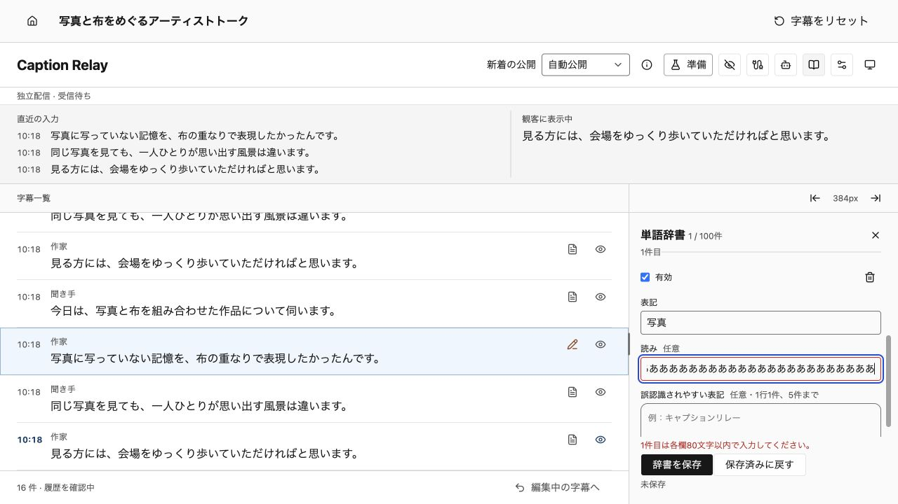
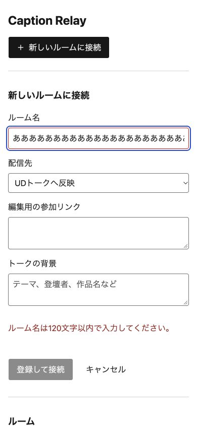

# アクセシビリティの確認

ホーム、字幕の訂正、AI・辞書・表示・接続の設定、観客画面を確認した。impeccableの監査に、実APIを使ったブラウザのキーボード操作とアクセシビリティ情報の検査を組み合わせている。音声や外部AIは使っていない。

## 修正した問題

| 優先度 | 修正前の支障 | 修正後 |
|---|---|---|
| P1 | ホーム・AI・辞書のエラーを、入力欄から識別できない | 該当欄を `aria-invalid` で示し、`aria-describedby` で理由へ関連付ける。正常な欄には付けない |
| P1 | 辞書の「誤認識されやすい表記」と読み上げ名が異なる | 読み上げ名にも画面のラベルを含める |
| P1 | 空欄の境界が薄く、入力する場所を見分けにくい | ホームと操作画面の入力境界用 `--input` を `#737373` に統一する |
| P1 | 右ペインをポインターだけで変えるにはドラッグが必要 | 左右のボタンでも24pxずつ変更できる。ドラッグ・キー操作・右端での収納も使える |
| P1 | 観客の字幕更新を支援技術へ通知する役割がない | 字幕を名前付きの `log` とし、追加と訂正を通知対象にする。設定プレビューは通知しない |
| P2 | ホームの取消、辞書の追加・削除でフォーカスが途切れる | 取消は起点、追加は新しい表記欄、削除は隣の単語か追加ボタンへ移る |
| P2 | ホームへの遷移でキャッシュされた旧版が表示される | ホーム・操作・観客のHTMLに `Cache-Control: no-cache` を付け、再検証する |

辞書の検証は、メッセージと対象の行・欄を返す。検証とフォーカス先はMediatorが決め、Presenterが描画パラメータへ変換する。Viewはその指定を描画し、DOMのフォーカスを移す。フォームを別のルームへ切り替えた際は、前のエラー指定を解除する。

## 確認した操作

1. ルーム名の上限超過を通知し、取消後に新規ボタンまたは元の設定ボタンへ戻る。エラーのある下書きから正常な保存済みルームを開く場合も確認する。
2. 辞書を追加し、表記・読み・誤認識例のエラーを該当欄へ関連付ける。削除後も隣の欄か追加ボタンから操作を続けられる。
3. AIの背景が上限を超えた場合に理由を確認し、修正して保存する。確認ダイアログのEscapeで取消し、起点へ戻る。
4. 右ペインをクリックで384→408→384pxへ変更し、字幕の下書きを保つ。390×844pxの画面では設定欄へTabで移り、横にはみ出さない。
5. 実APIで公開字幕を追加・訂正し、観客の字幕ログへ届く。プレビューにはログの役割を付けない。

入力境界と白背景のコントラストは、修正前の約2.52:1から約4.74:1になる。淡い灰色のパネルに対しても3:1を超える。文字・エラー文・青いフォーカス表示を併用する。

## 検査の範囲と限界

アクセシビリティの暫定評価は3/4。キーボード、入力の名前と状態、更新通知の役割、境界のコントラストを改善した。認証を持たないローカルPoCを、隔離した実FastAPIと背景の実ブラウザで検査している。

impeccableのソース・ホーム・操作画面の検出は指摘なしで終了した。観客画面のURL検出はタイムアウトしたため、成功とは扱わない。観客画面は実ブラウザで、字幕ログの役割・実配信・追加と訂正を確認した。

実スクリーンリーダーの発話、音声操作、実端末のタッチ、強制配色、ブラウザの200%拡大は今回の検証に含めていない。動きを減らすCSSはソースで確認した。WCAG全体への適合を保証する評価ではない。検出器の指摘なしだけを、アクセシビリティの証拠にしない。

回帰テストは `rooms.test.tsx`、`roots.test.tsx`、`presenters/display-scroll.test.tsx`、`backend/tests/test_api.py` にある。[画面と検証記録](assets/accessibility-2026-10-26/verification.json)を参照する。

## 判断の根拠

- [W3C：入力エラーの通知](https://www.w3.org/WAI/tutorials/forms/notifications/)と[aria-invalid](https://www.w3.org/WAI/WCAG21/Techniques/aria/ARIA21.html)
- [W3C：画面のラベルと名前](https://www.w3.org/WAI/WCAG22/Understanding/label-in-name)
- [W3C：非テキストのコントラスト](https://www.w3.org/WAI/WCAG22/Understanding/non-text-contrast.html)
- [W3C：ドラッグ操作の代替](https://www.w3.org/WAI/WCAG22/Understanding/dragging-movements.html)
- [W3C：連続する更新を通知するlog](https://www.w3.org/WAI/WCAG22/Techniques/aria/ARIA23)
