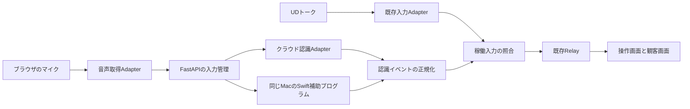

# 音声認識を切り替えられるマイク入力

初手は **OpenAI**、試験上限は **合計100円・送信合計20分以内**と決定した。publish の PR が main に入るまでは設計の更新だけを行う。実装は取り込み後の main 上でテストを先に書く。日本語の精度・遅延は未実測。

## 目的

UDトークがなくても会場のマイクから文字起こしでき、UDトーク／マイク入力、マイク入力の音声認識を切り替えられるようにする。既存の認識モデルへ接続する入力部品を追加し、字幕の編集・手修正保護・公開を既存の Relay に集約する。

## 再開に必要な事実

確認日：2026-10-10。作業ブランチは `Eotel/self-transcription`、確認した現行コードの先頭は `1ed0286`。単一 FastAPI プロセス、React/XState、メモリ内状態。現行の入力・編集・公開は[現行仕様](../../current-behavior.md)、境界は[構成](../../../ARCHITECTURE.md)を参照する。

入力は `SourceEvent` の `utterance_id`・`revision`・`text`・`is_final`・`source_event_id`。取消は `removed=true`、空文、`is_final=false`。途中結果は操作画面に保持し、現在は確定結果だけを自動公開する。手修正済みの表示文は後着入力から保護する。

publish 作業の入力部品・接続設定・AI 接続の変更が先行する。2026-10-10 の確認で [#11](https://github.com/shiftone-ai/caption-relay/pull/11) は merge 済み、接続切替の修正を含む [#12](https://github.com/shiftone-ai/caption-relay/pull/12) は未merge。#12 が main に入った後、自分の文書変更を保ってその main を取り込み、入力境界を再確認する。旧作業場は読み取り専用。

根拠と比較：[クラウド候補](../../research/2026-10-10-cloud-transcription.md)、[OpenAI・Apple・Whisper](../../research/2026-10-10-openai-apple-transcription.md)。公式資料での対応と実測結果を分ける。料金・モデル名・利用枠は実装再開時に再確認する。

## 範囲と制約

- 初期対象は1つの稼働入力。UDトーク、OpenAI、対応 Mac の Apple 認識を切り替える。ほかのクラウドは Adapter を足せる契約まで設計し、一度に全提供元を実装しない。
- 認識モデルの開発、音声の永続保存、話者推定、要約・翻訳は対象外。音声を受け取ることから、発話の正解や韻律まで分かると説明しない。
- この段階ではコード・API・画面を変更しない。publish の merge 後はテストを先に書く。接続設定は publish 後の既存画面へ追加し、並行する設定経路を作らない。
- キーはこのリポジトリ用に用意されたものだけをバックエンドで使う。他プロジェクトのキーや、用途を確認できない継承環境変数・親ディレクトリの設定を使わない。キー本文を表示・転記せず、参加リンク・内部接続先・音声・認識文もログ・文書・テストへ残さない。値の例は `.env.example` だけに置く。
- 本番配置と認証は publish 後の設定から再確認する。現在の未認証 PoC を公開サービスとして運用しない。merge・公開設定変更・キー作成は利用者の明示判断が必要。

## 決定した認識先と試験条件

| 選択 | 理由と制約 |
|---|---|
| **OpenAI を最初に実装（決定済み）** | 現行のライブ認識モデル `gpt-live-transcribe` を使う案。**USD 0.017/分**で、アプリ側の VAD と commit が必要。日本語指定の受理・精度とアカウントの利用可否は未確認。[根拠](../../research/2026-10-10-openai-apple-transcription.md) |
| Apple を追加 | 同じ対応 Mac 上で認識する Swift 経路を用意する。この Mac の日本語モデルは確認済み、実認識は未測定。[根拠](../../research/2026-10-10-openai-apple-transcription.md) |
| ほかのクラウド | AmiVoice などの比較を残す。今回の初手には採用せず、精度の順位も付けない。[比較](../../research/2026-10-10-cloud-transcription.md) |

試験上限は **合計100円、送信合計20分以内**。OpenAI の20分は基本料金 **USD 0.34**の見積もりで、為替・税・地域処理の追加料金・課金丸めは含まない。実測前に料金とアカウントの課金条件を確認し、円換算と終了処理の余裕を含めて100円以内に収まる送信時間を設定する。上限を裏付けられなければ有料送信を始めない。

音声サンプル数から無音を含む送信時間を集計し、再送も加算する。再接続・試験のやり直し・再起動でも累計をリセットしない。本文やキーを含まない試験使用量を管理し、費用見積もりと時間のどちらかの上限より前に送信を止め、接続を閉じる。提供元の請求上限機能は未確認なので、その機能だけに依存しない。

## 入力の構成案

### マイクと Apple の経路

1. マイクはブラウザの `getUserMedia()` で取り、AudioWorklet から時刻・連番を付けた PCM を同じアプリの WebSocket へ送る。実際の入力周波数を通知し、必要な変換は認識 Adapter が所有する。最初は20〜100msの音声片を試し、最適値は実測で選ぶ。[ブラウザの条件](../../research/2026-10-10-openai-apple-transcription.md#共通のマイク入力に必要な条件)
2. FastAPI が1つの稼働入力と有界キューを所有し、選んだ Adapter だけに渡す。クラウドにはバックエンドから認証する。音声取得側に提供元固有のキーや判定を持たせない。
3. Apple はブラウザから直接呼ばず、FastAPI が起動・終了する Swift 子プロセスを使う。標準入力は長さ付き PCM フレームと音声時刻、標準出力は JSON Lines の認識イベント、標準エラーは本文を含まない診断にする。別の常駐サービスや待受ポートは作らない。
4. Swift は対応 OS・端末・正規化した日本語 locale・アセットを確認し、SpeechTranscriber の暫定結果を有効にして SpeechAnalyzer に音声バッファを渡す。対応形式へ変換し、途中範囲・確定境界・終了を読み取る。API と範囲処理の根拠は[Apple の経路](../../research/2026-10-10-openai-apple-transcription.md#apple-の具体的な接続経路)を参照する。
5. Apple はブラウザとバックエンドが同じ対応 Mac のローカル運用から検証する。Linux では選択不可の理由を返し、クラウドへ自動切替しない。Mac が認識を行う配置と、利用者の端末内で音声が完結する配置を区別する。

### 最初に実装する OpenAI の経路

1. FastAPI の Adapter から Realtime WebSocket に接続し、transcription セッションで `gpt-live-transcribe` を設定する。音声はガイドに合わせた24kHz・16bit PCM に変換し、`turn_detection` は省略または `null`。設定の受理後に送信を始める。[公式手順](https://developers.openai.com/api/docs/guides/realtime-transcription)
2. 発話区切りはアプリ側の VAD が所有する。ライブラリ・無音時間・長発話の分割上限は publish 後に依存関係を確認して決める。`append` と発話末尾の `commit` を直列化し、空音声の commit と同じ区切りの重複 commit を防ぐ。正常停止時の未処理音声も一度だけ区切り、期限付きで確定を待つ。
3. delta を `item_id` ごとの全文に蓄積し、completed の全文で確定する。到着順で別発話へ割り当てず、認識開始時の順序を保つ。確定後の遅着 delta・重複 completed・空結果の扱いをテストで固定する。
4. `languages` に日本語のヒントを設定し、受理を確認する。`delay` は低遅延の設定から測定し、固有名詞のヒントは必要な場合だけ使う。日本語精度・遅延・利用枠を資料だけで保証しない。
5. 認証・利用枠・予算の失敗では接続を閉じ、他の認識へ自動送信しない。実測にはリポジトリ専用のキーが必要。未配置でも設計と、merge 後の模擬テスト・実装は進め、キーが必要な実接続の時点で `要判断:` として止まる。

### Adapter の共通契約

音声認識 Adapter は `start(config)`・`push_audio(frame)`・`finish()`・`cancel()` と、認識・接続状態イベントのストリームを持つ案とする。UDトークは音声を扱わず、既存 Adapter の結果を入力照合へ渡す。内部の型は実装時に定義し、外向け API と生成型の所有元を増やさない。

| イベント／情報 | 契約 |
|---|---|
| 音声フレーム | 入力の世代、増加する連番、サンプル数・周波数・形式・音声上の開始時刻。欠落や形式不一致を黙って補間しない。 |
| 途中結果 | 世代内の安定した発話キー、本文の全文、任意の音声範囲。delta は提供元 Adapter が全文へ変換する。空の新規行を作らず、同本文の途中更新は省略する。 |
| 確定／撤回 | 確定は最後の全文で `is_final=true`。同本文でも途中から確定への遷移は必ず通知する。明示撤回だけを `removed=true` に写し、切断や空文のエラーを確定・撤回と推測しない。 |
| 状態／失敗 | 準備、稼働、再接続、停止、権限・認証・上限・形式・提供元エラー。再試行可否と音声欠落範囲を持つ。字幕本文にエラーを混ぜない。 |
| 正規化 | 発話IDは入力種別＋世代＋ローカル発話番号で名前空間を分ける。改版は発話ごとに1から増やし、受理済みイベントの再送は同じ `source_event_id` を使う。結果の時刻とサーバー受信時刻は別に扱う。 |

SourceEvent への変換後は同一プロセスの既存取り込み口を使い、HTTP で自分自身へ送らない。独立した入力 API の利用者は既存の入力ルートを使う。稼働入力の世代照合は Relay に入る前の共通入口で行い、UDトークの停止漏れ・旧音声接続の遅着結果も除外する。外部 API の送信者も publish 後の識別・権限機構へ合わせて入力元を照合し、未識別の入力を稼働中の認識へ無条件に混ぜない。

### 提供元ごとの変換

| Adapter | 固有の変換と必須検証 |
|---|---|
| AmiVoice（将来の候補） | `C` を認識単位の開始、`U` を途中、成功した `A` を確定にする。音声上の `S/E` と認識完了を区別する。`E` だけで公開しない。複数発話の対応と遅着は公式イベント順序と音声時刻で検証する。`U` の末尾ダミー形態素を仕様に従って除き、本文の任意の句読点を削らない。`nolog` の末尾スラッシュを含む固定 URL を検査する。[根拠](../../research/2026-10-10-cloud-transcription.md) |
| OpenAI | `item_id` を照合キーにし、delta を蓄積、completed の全文で確定。アプリ側 VAD の区切りと commit の対応、完了の逆順、空音声を検証する。日本語が受理されるかを有料試験前の設定確認項目にする。[根拠](../../research/2026-10-10-openai-apple-transcription.md) |
| Apple | 未確定の音声範囲を置き換え、分割・統合に伴う旧未確定行を撤回する。確定済みの範囲は変更しない。`resultsFinalizationTime` を越えた保持済み結果も確定させ、同一範囲の final 再通知だけを待たない。空文による撤回と新しい範囲の行を検証する。[根拠](../../research/2026-10-10-openai-apple-transcription.md) |

### 切替・停止・再接続

選択だけでは録音や課金を始めず、「開始」で権限要求と準備を行う。マイクの許可・入力形式を確認してから課金接続を開く。切替は旧入力を止めて正常終了時の確定結果を期限付きで待ち、旧世代を無効にしてから新入力を開始する。準備失敗では停止状態と理由を示し、別提供元への送信は行わない。

一時切断は同じ提供元へ上限付きで再接続する。新しい認識接続には新しい世代を振り、旧結果を無視する。未確定文を勝手に確定せず、既存の公開文と下書きを保つ。提供元が再開を保証しない場合は音声を自動再送せず、欠落を状態表示する。認証・予算・権限のエラーは自動再試行しない。

音声キュー・送信待ち量・同時接続・試験合計送信時間に上限を設ける。追いつかないときに無制限に録音を蓄積しない。停止・ページ離脱・ブラウザ接続切断・サーバー終了で track、AudioContext、WebSocket、提供元接続、Swift プロセスを解放する。

## 画面と API の所有

publish 後の接続設定へ「入力元：UDトーク／マイク」「音声認識」「マイク」「開始／停止」を追加する。準備状態、使用中のマイク、切断・欠落・利用上限と解決方法を示す。利用できない認識は理由を添え、内部の世代・接続用キー・プロトコル名を画面に出さない。「字幕を隠す」は認識停止と分ける。

Root → Mediator → Adapter、Presenter → Passive View の現行責務を保つ。録音と通信を View に置かない。API 案は設定取得・変更、開始・停止、利用可能な認識と稼働状態、音声 WebSocket。publish 後の設定 API に合わせて決め、Pydantic から型を生成する。

初期運用はローカルの操作端末。音声 WebSocket は許可 Origin と稼働入力の所有権を照合し、2つ目の入力を拒否する。観客へは既存公開モデルだけを送り、音声・原文・認識の管理情報を追加しない。将来リモート配置へ広げる前に操作権限と TLS を実際の配置に合わせて決める。

## 残りの作業

1. publish #12 の main への merge を確認する。取り込み後の入力管理・接続設定・認証を読み直し、VAD とモデル・料金を再確認して、この計画の差分を直す。
2. 共通入力契約・OpenAI の公式イベント仕様に沿う秘密を含まない fixture・世代切替・手修正保護・commit と上限のテストを先に書き、失敗を確認する。実 API の fixture が取れた場合だけ、実イベントとして記録する。
3. 共通のブラウザ音声入力と OpenAI Adapter、接続設定を実装する。費用と音声時間の制限を付け、リポジトリ専用のキーがあれば上限内で実認識を測る。なければ実接続が必要な時点で止まる。
4. Apple の Swift 補助プログラムと Adapter を実装し、クラウド／Apple／UDトークの切替を実マイクで確認する。Linux では Apple の実認識成功を主張しない。
5. 対応文書・生成型を更新してチェックと実ブラウザ検証を通す。完了した計画はその変更で削除し、結果を PR の説明へ記録する。PR の assignee は Eotel、CI と未解決レビューを確認し、merge は利用者の確認後に行う。

## 今と次の一手

今は OpenAI を初手とする設計更新まで完了し、publish #12 の merge 待ち。再開時は `gh pr view 12 -R shiftone-ai/caption-relay --json state,mergedAt,mergeCommit` で確認する。未mergeならコード・テストを変更しない。merge 後は main を取り込み、境界の再確認と失敗するテストから始める。

## キーの確認と要判断の条件

2026-10-10 にこの worktree のルート・`backend`・`frontend` の `.env*`（example を除く）で配置の有無だけを調べたが、設定ファイルは見つからなかった。キー本文、他プロジェクトの設定、継承した API キーは調査・利用していない。

初手と試験上限の再判断は不要。`要判断:` は実接続に必要なリポジトリ専用キーがない場合、または上限内の試験を裏付けられない場合に出す。キー作成・契約は利用者が行い、キー本文をチャットや GitHub へ貼らない。今はキーを求めず、publish 待ちとする。

## 検証と受け入れ条件

| 対象 | 失敗を検出できる確認 |
|---|---|
| 入力契約 | 途中→改版→確定（同本文含む）、空文・取消、重複・順不同、旧世代、手修正文保護を検査する。認識の途中文が現在の公開ルールを変えない。 |
| 音声と終了 | 周波数変換・連番欠落・権限拒否・過負荷・ページ離脱・再接続・切替後の旧結果を確認し、録音・課金接続・子プロセスが残らない。上限と無音による提供元切断も検証する。 |
| Apple | macOS の実 API と日本語実音声、範囲の置換と確定境界、モデル未導入を検証する。CI の模擬契約確認と macOS の実認識を区別する。 |
| UI と配信 | 背景の実ブラウザで開始→発話→原文受信→訂正・保存→観客表示→認識切替→停止を操作し、実 API 通信を記録する。合成音声と物理マイクの結果を分ける。 |
| 品質・全体 | 同じ同意済み日本語音声で CER、数字・固有名詞・否定の誤り、最初の途中文までと発話終了から確定・表示までの p50/p95、途中更新の間隔、欠落、送信時間・請求見積もりを比較する。まず短時間、次に許可範囲の継続運転。`bash scripts/check.sh`、相対リンク、秘密値の確認を通し、push 後の CI を確認する。 |

精度と遅延の合否しきい値は、初回実測の比較結果を利用者が確認して決める。模擬 Adapter の成功を認識精度や実サービス接続の証拠にしない。
