# Caption Relay の使い方

[準備と起動](setup.md)に従ってアプリを起動し、ホーム <http://127.0.0.1:24681/> を開きます。AI校正を使う場合は、起動前にAPIキーを設定してください。

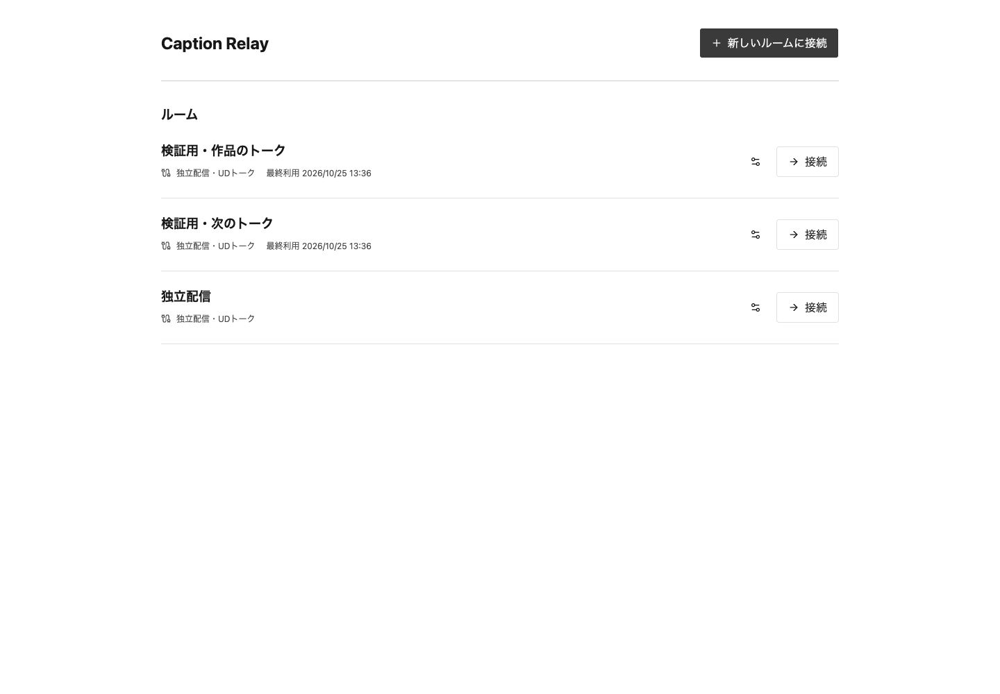

## ルームを選ぶ

1. 登録済みのルームは「接続」を押します。初回の画面確認には「独立配信」を使えます。
2. 追加するときは「新しいルームに接続」を押し、名前と配信先を選びます。UDトークへ反映する場合は編集用の参加リンクを入力します。
3. 必要ならトークの背景を記入し、「登録して接続」を押します。登録済みの設定は一覧の設定アイコンから変更できます。

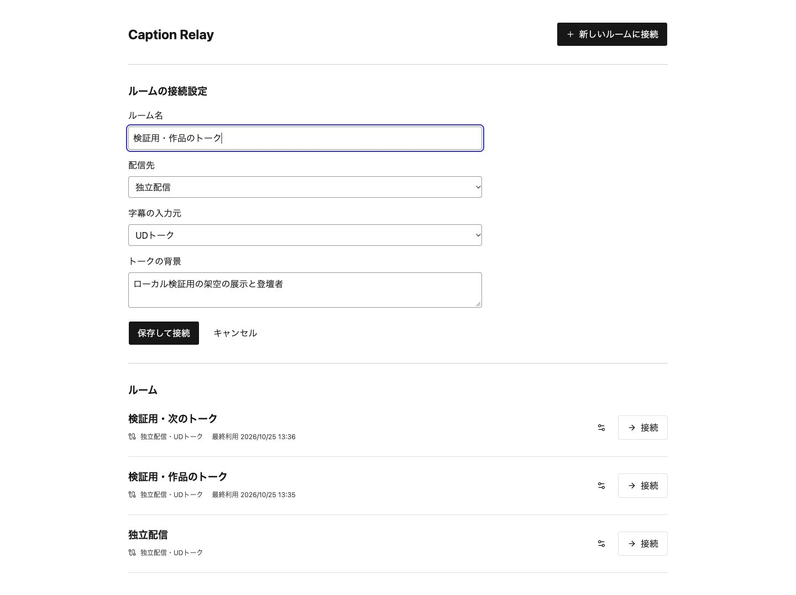

ルーム画面の左上のホームアイコンで戻れます。別のルームへ接続すると、前のルームの入力を終了します。次のトークの前に字幕を消す場合は「字幕をリセット」を押し、確認画面で実行します。ルームの設定とUDトーク側の字幕は残ります。詳しくは[ルームの接続と字幕リセット](rooms.md)を参照してください。

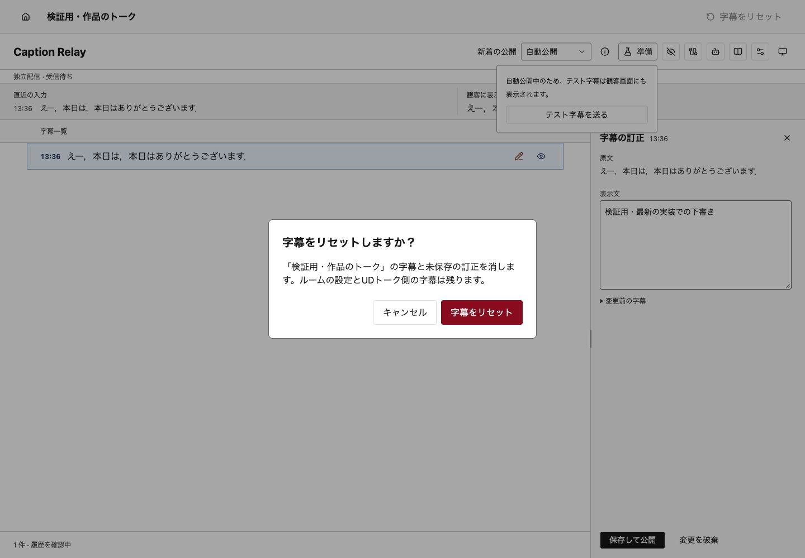

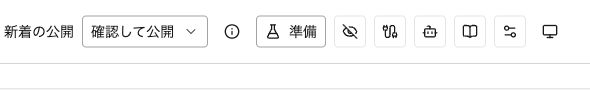

このページの画像と字幕は説明用の合成データです。画像の撮影では、実際のUDトーク、物理マイク、AI提供元には接続していません。

## 1. 入力と配信先を選ぶ

1. 上部の接続アイコン（「字幕入力の接続設定」）を押します。
2. 「字幕の配信先」を選びます。
3. 独立配信なら「字幕の入力元」を選び、「接続を適用」を押します。

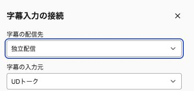

| 配信先 | 字幕の入口 | 訂正した字幕を見る場所 |
|---|---|---|
| **独立配信** | UDトークのZoom連携、またはマイク | Caption Relayの観客画面 |
| **UDトークへ反映（試験接続）** | 編集を許可したUDトークの参加リンク | UDトーク純正の字幕画面 |

### 独立配信でUDトークを使う

1. 「字幕の入力元」を「UDトーク」にします。
2. 画面の「UDトークに設定する送信先」を、同じMacで動かすiOS版UDトークの「Closed Caption Services」→「Zoom」に設定します。送信先は接続ごとに変わるため、ここには転記しません。
3. UDトーク側で「Send Speaker Name」を有効にした場合は「送られる字幕」を「発話者名と本文」にします。無効なら「本文のみ」を選び、「接続を適用」を押します。
4. UDトーク側で「Enable sending closed caption」を有効にし、音声認識を始めます。操作画面の「直近の入力」に字幕が届くか確かめます。

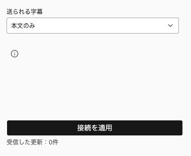

「受信中」は通信の応答を表します。音声認識や純正画面への表示まで確認した状態ではありません。接続方法は[UDトークの入力接続](udtalk-input.md)を参照してください。

### 独立配信でマイクを使う

1. 「字幕の入力元」を「マイク」にして、音声認識を選びます。
2. 「接続を適用」を押します。この時点では録音しません。
3. マイクを選んで「認識を開始」を押します。終わったら「認識を停止」を押します。

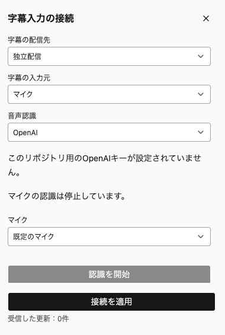

OpenAIには専用キーと試験費用の設定、Appleには対応するMacと日本語モデルが必要です。準備と制限は[マイク入力](microphone-input.md)を参照してください。

### Caption Relayで訂正し、UDトークの画面で見せる

1. UDトークで本人のトークを公開し、**編集用の参加リンク**と**観客向けのWeb閲覧リンク**を用意します。
2. Caption Relayの「字幕の配信先」で「UDトークへ反映（試験接続）」を選び、編集用リンクを入力して「接続を適用」を押します。閲覧用リンクでは編集できません。
3. 観客はUDトークのWeb閲覧リンクを開きます。パスコード付きなら、その画面でパスコードを入力します。
4. 新しく届いた確定字幕を訂正し、「保存してUDトークへ反映」を押します。AIを使う場合は、次の「AI設定」を保存してから音声認識を始めます。
5. UDトーク純正の字幕画面で結果を確かめます。このモードではCaption Relayの観客画面を使いません。

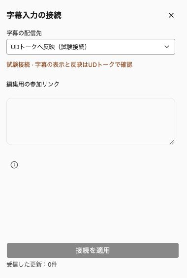

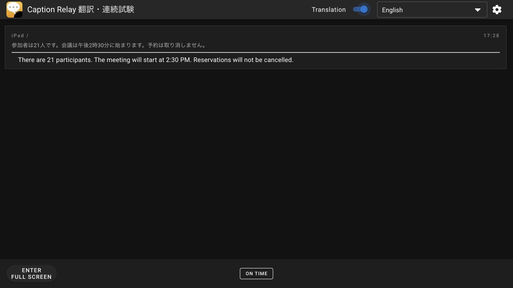

翻訳はUDトーク側で設定します。純正Web字幕では「Translation」をオンにして言語を選びます。

純正アプリへの手動訂正とAI訂正は合成音声を使った実接続で確認しています。UDトーク経由の英訳更新と60分・120回の連続運転も合成音声で確認しました。会場の音響と60分を超える運転は未確認です。確認範囲は[実接続の記録](udtalk-input.md#復旧後の実接続確認)を参照してください。

## 2. AIを使う場合だけ設定する

1. 起動前に設定したAPIキーがあることを確認します。後から追加する場合はサーバーを停止し、[キーを設定して再起動](setup.md#ai校正のapiキー)します。入力接続も設定し直してください。
2. 上部のロボットアイコン（「AI設定」）を押します。
3. 「モデル」で使うAIを一つ選びます。
4. 必要なら「トークの背景」にテーマ、登壇者、作品名などを入れます。
5. 「AI設定を保存」を押します。背景と最近の字幕を参考に、**次の確定字幕**から校正します。

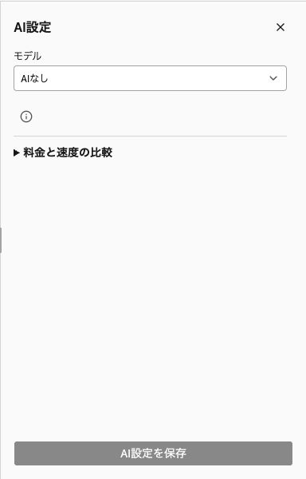

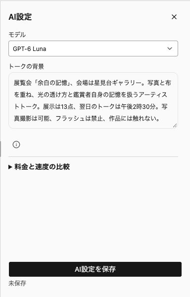

初期値は「AIなし」です。GPT-6 Lunaなどのモデルを選ぶと有効になります。キー未設定や通信失敗では原文を保持します。AIの結果は意味が正しいとは限らないため、公開文を確認してください。AIの校正も手直しも同じ「表示文」で編集でき、一覧の状態アイコンで区別できます。候補と料金、実接続の確認範囲は[AIの選択と振り分け](ai-routing.md)を参照してください。

AI処理中は原文を残し、「AI校正中」と動くアイコンを表示します。

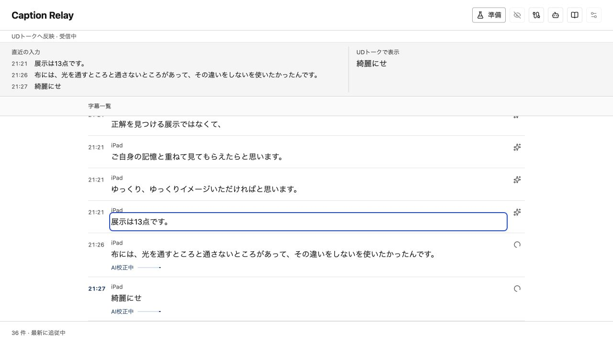

## 3. 必要な単語を辞書に入れる

1. 上部の本のアイコン（「単語辞書」）を押し、「単語を追加」を押します。
2. 「表記」を入力します。必要なら「読み」と「誤認識されやすい表記」も入力します。
3. 「辞書を保存」を押します。

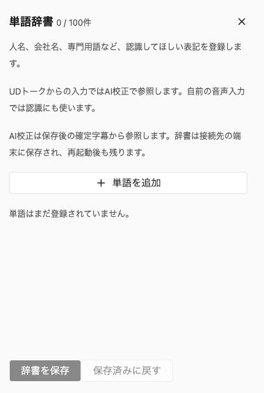

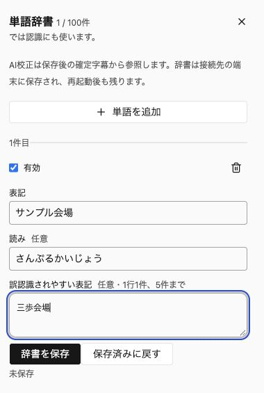

UDトーク入力ではAI校正が辞書を参照し、UDトーク側の認識辞書は変えません。自前の音声認識には次の認識開始から反映します。辞書は接続先の端末に保存され、再起動後も残ります。詳しくは[単語辞書](dictionary.md)を参照してください。

## 4. 字幕を確認して訂正する

1. 入力が来たら、「直近の入力」と「字幕一覧」で対象の文と時刻を確認します。
2. 字幕の行を押します。キーボードでは字幕の本文へ移動し、Enterで開けます。
3. 「原文」を見ながら「表示文」を直し、独立配信では「保存して公開」を押します。Ctrl / Command + Enterでも保存できます。

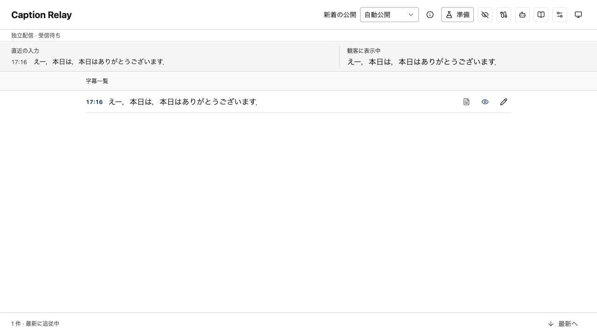

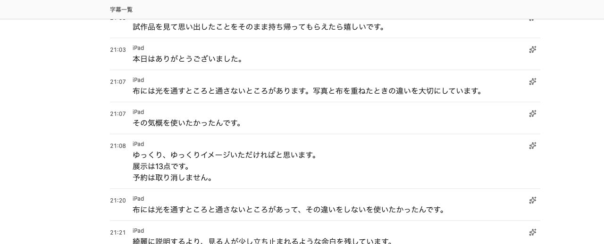

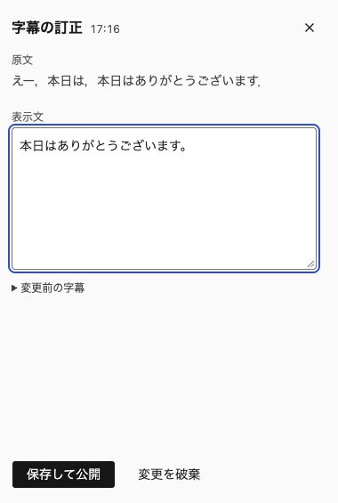

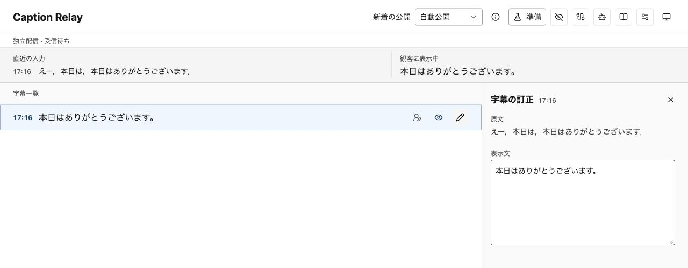

下書きは保存するまで観客へ出ません。編集欄を閉じて開き直しても、同じページ内では下書きを保持します。保存失敗や他の編集者との競合でも下書きを残すので、表示された最新の文と比べてから再保存してください。ページの再読み込みや終了後には下書きを復元できません。

以前の文に戻す場合は、訂正欄の「訂正履歴」から文を選んでください。表示文へ取り込んだ内容を確認し、保存します。選ぶだけでは観客の字幕は変わりません。履歴は字幕のリセットやサーバーの再起動で消えます。

「保存結果を確認」が出た場合は、そのボタンを押してください。先ほどの保存が成功していれば、その結果を確認します。成功済みの訂正を二重に送りません。本文を編集すると、新しい保存として扱います。

確定済みの字幕は、字幕を表示している間に「保存して再公開」で一件ずつ公開できます。非表示にした字幕や表示範囲外の字幕にも使えます。下書きがあればその文を保存し、選んだ字幕を観客表示の末尾へ移します。他の非公開字幕は公開しません。

### 右の欄の幅を変える

1. 右の欄の左端を左右へドラッグします。
2. 右端まで寄せて離すと、欄を収納します。
3. 設定アイコンや字幕の行から開き直すと、直前の幅と未保存の入力に戻ります。

欄の上にある左右の矢印でも、24pxずつ幅を変えられます。境界へTabで移動すると、左右キーでも変更できます。HomeまたはEnterで収納します。狭い画面では欄を下に並べます。

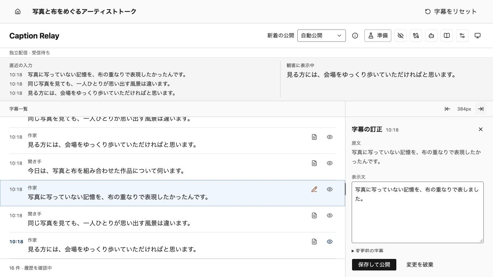

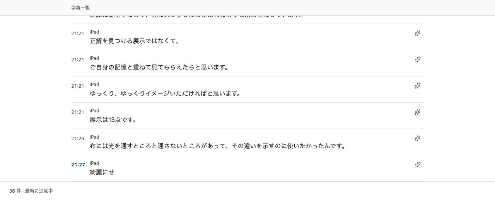

### 新着を公開する前に確認したい場合

独立配信で使う操作です。UDトークへ反映するモードでは「新着の公開」は表示されません。

1. 上部の「新着の公開」を「確認して公開」にします。
2. 字幕一覧で文を確認し、「保存して公開」を押します。

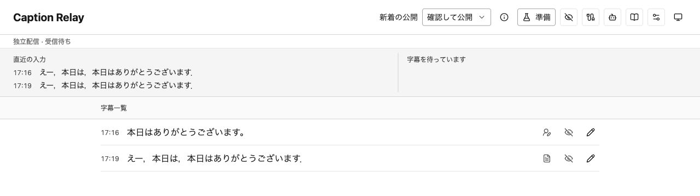

「自動公開」では確定字幕を届いた順に公開します。どちらの方法でも、編集中の文は保存するまで公開しません。「準備」の「テスト字幕を送る」は画面と配信の確認用です。音声認識やUDトークの実接続は確認できません。

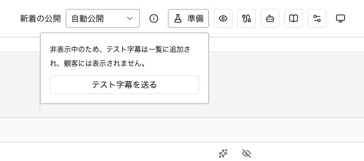

## 5. 観客画面を表示する

1. 独立配信で、上部の画面アイコン（「観客画面」）から観客画面を開きます。
2. 必要なら操作画面の「表示設定」で表示方式や文字サイズを選び、「表示設定を反映」を押します。
3. 観客画面を表示先のディスプレイへ移し、「全画面」を押します。終了時は「全画面を解除」または Escape を使います。

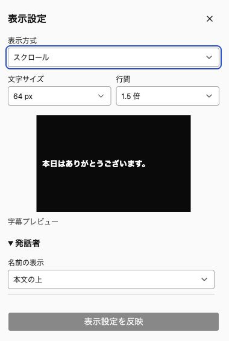

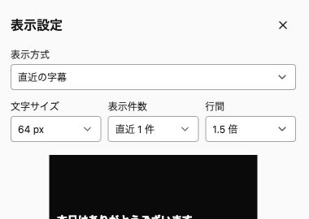

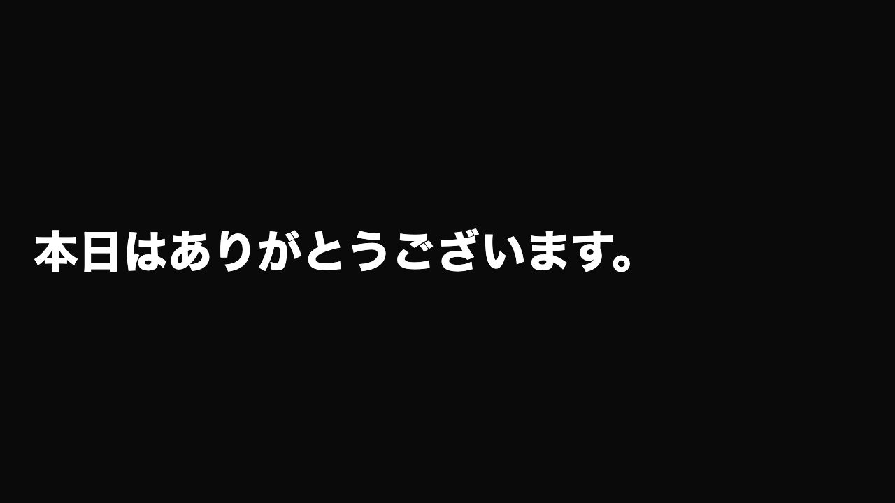

過去の字幕を読み返すためにスクロールした後は、「最新へ」で新着への追従を再開できます。「字幕を隠す」は観客への表示だけを止め、入力と編集は続きます。「字幕を表示」に戻しても、非表示中の字幕は自動で再公開しません。

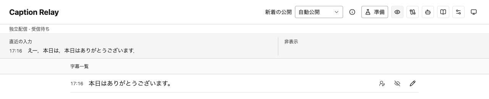

## 6. 終了する

1. マイク入力中なら「認識を停止」を押します。UDトークから入力している場合は、UDトーク側の認識と送信を止めます。
2. 試験用にUDトークを公開していたら、UDトーク側で公開を終了します。
3. 観客画面を全画面表示していたら解除します。
4. サーバーを起動したターミナルで Ctrl+C を押します。

字幕履歴は再起動すると消えます。ルームの接続先・背景・AI・表示設定と単語辞書は、接続先の端末に残ります。認証と永続的な字幕保存は提供していません。
