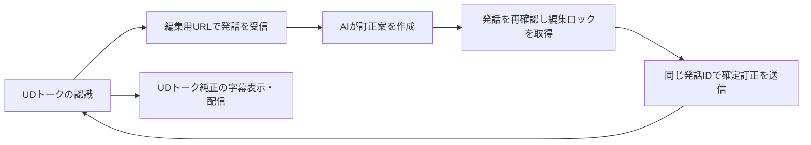

# UDトークへの訂正送信：純正編集アプリの通信解析

確認日：2026-10-24

**純正編集アプリの通信解析を基に、2026-10-24に実サービスへの編集参加と手動訂正を確認した。合成音声の字幕が、Caption Relayからの保存で純正iOS版と純正Web字幕の両方に反映された。**

今回は公式配布のMac / Windows版を解析した。Windows版の元のDLLをオフラインで実行し、共有URLの復号結果と、送信前の訂正・ロック・解除要求を確認した。コードを変更したDLLや、独自に再実装した応答を成功の根拠にはしていない。

Caption Relayには、この解析を基に[独立配信と編集参加の2経路](../udtalk-input.md)を実装した。編集参加は試験接続として提供し、模擬HTTPで要求・ロック・競合・失敗時の保護を検証している。以下の元のDLLによるオフライン実行、実装の模擬テスト、[復旧後の実反映](../udtalk-input.md#復旧後の実接続確認)はそれぞれ別の証拠として扱う。[公開資料の調査](udtalk-editor-protocol-sources.md)も参照する。

## 1. 解析対象と確認方法

| 対象 | 配布元 | 調査した版 |
| --- | --- | --- |
| UD Talk for Mac | [公式DMG](https://service.udtalk.jp/apps/udtalk-pc/mac/UDTalk-for-Mac.dmg) | Version 99、Build 15、x86_64 / arm64 |
| UD Talk for Windows | [公式MSIX](https://service.udtalk.jp/apps/udtalk-pc/win/UDTalkInstaller.msix) | パッケージ 99.0.0.0、x64、同梱.NET 8.0.25 |

調査時のSHA-256：

| ファイル | SHA-256 |
| --- | --- |
| Macの実行ファイル `Contents/MacOS/UDTalk for Mac` | `0c283216f0ac09bfecef32957eb7401368a0cac7b311714f7671023b035242de` |
| WindowsのMSIX | `a5434ed0e082a6e55ddc64c9dc4528944a2e1a59dc030deb26ee8446ebcd6762` |
| `UDTalk_NetworkLibrary.dll` | `76d84fa90083b163d5cb81eefc9c4ca7ed896a09e739821d829ae00985074f7c` |
| `UDTalk.dll` | `4d1bc8450cc69bab4461a54924e04e7d5addefeca51405d593f00f68a2865974` |

Mac版はDMGを読み取り専用でマウントし、`otool -ov`のObjective-Cメソッド情報と`otool -tvV`の逆アセンブルを照合した。`dyld_info -fixups`で参照先を解決し、文字列・セレクターと引数の対応を確認した。

Windows版はILSpy CLI 11.1.0.9782で.NETアセンブリを読んだ。さらに元のx64 DLLを、Mac上のRosettaと.NET 10.0.12のx64ランタイムで実行した。この実行はURL解析と要求の組み立てだけで、Windows版の画面や音声認識を動かした検証ではない。

## 2. 共有URLの復号

Windowsの`UDTSharingTalkOperator.getSharingTalkInfoFromURL()`とMacの`sharingTalkInfoFromURL:`が、クエリーの`token`を読み取る。Web閲覧リンク `https://live.udtalk.jp/…` のパスをそのまま編集用トークIDとして使う処理ではない。

復号処理は次の順序だった。

1. `token`をURLデコードし、CRLFを許容してBase64からバイト列へ変換する。2026-10-24に発行した実URLには64文字ごとの改行が含まれていた。
2. AES-256-CBCで復号する。鍵はUTF-8の`udtalk`を32バイトまでゼロで埋めたもの、IVは16バイトのゼロ。
3. PKCS#7のパディングを取り除き、UTF-8のJSONとして読む。

JSONの主要フィールド：

| フィールド | 純正クライアントでの用途 |
| --- | --- |
| `talkId`、`entryKey` | 参加先と参加時のキー |
| `readOnly`、`editOnly` | 閲覧・編集のみ・発言可能という画面上の参加制限。`readOnly=1` かつ `editOnly=1` は「Edit Only」で編集可能 |
| `userName`、`allowSave` | 接続先の表示名と保存の可否 |
| `sharingLimit` | Unix秒の共有情報。純正は接続先一覧に表示する。参加キーの失効判定を端末時計で代用しない |

架空の試験情報を暗号化したURLを元のWindows DLLへ渡し、日本語名、トークID、参加キー、権限、期限が一致することを確認した。不正なBase64のURLは`null`になった。権限や期限を変更して実サービスへ参加する試験はしていない。

ここでの暗号方式はURLを読むための実装情報である。復号できたことは、サービス側の編集許可を取得できた証拠にはならない。独自クライアントでも、編集用として発行されたURLの権限と期限を保持する必要がある。

## 3. 参加・受信・訂正のHTTP要求

通信先は`https://app.udtalk.jp`。Mac / Windows版とも、本文をJSONにしてPOSTし、`Content-Type: application/json`を付ける。共通パラメーターとして`v: "0.0.1"`を追加する。

### 参加と受信

| パス | 主要パラメーター | クライアントが読む結果 |
| --- | --- | --- |
| `/push/initialize/` | `u: "0"`、`n: 参加者名` | 成功時の`users.id`を自分のサービス上のIDにする。`signTalk` の `users` は配列の場合もある |
| `/push/signTalk/` | `u: 自分のID`、`t: talkId`、`k: entryKey` | Windows版は`status`が1または13なら受信を開始する。`meta`にはトークの追加情報が入る |
| `/pull/talkCurrent/` | `t`、`k` | `number`、`current`を受信カーソルにする |
| `/pull/talkMessage/` | `u`、`t`、`k`、`l`、`c` | `messages[0]`と`options[0]`。各要素の`meta`はJSON文字列 |
| `/push/awayTalk/` | `u`、`t` | 参加を解除するための要求 |

Mac版の`pushSignTalk:talkId:entryKey:readOnly:completion:`は、`readOnly`引数が真なら`r: "1"`、偽なら`r: "2"`を追加する。解析した共有参加の呼び出し元は偽を渡していた。Windows版は`r`を追加していない。**`r=2`だけを編集権の意味に読み替えることはできない。**

`l`と`c`は通信のカーソルであり、Caption Relayの入力改版とは別である。純正は参加時に送受信のカーソルを初期化する。Windows版は編集参加の初回受信で直前5件を読む。共有URLの編集権を無視したり、カーソルを本文の改版番号として扱ったりする根拠は得られていない。

### 編集ロックと状態通知

| パス | パラメーター |
| --- | --- |
| `/push/lockMessage/` | `u`、`t`、`lgid`、`token` |
| `/push/unlockMessage/` | `u`、`t`、`lgid`、`token` |
| `/push/talkOption/` | `u`、`t`、`target: "0"`、`type: "1"`、`s: "1"`、`mt` |

`lgid`の順序は **`utteranceIdentifier + "_" + talkId`**。トークIDが先ではない。

Windows版は操作ごとにUUIDの`token`を作る。ロック取得では`status == 1`かつ`result == true`を成功として扱う。同じトークのほかの編集者へ、`talkOption`の`mt`で`phase: "locked"`または`"unlocked"`、端末ID、発話ID、結果、トークン、通知時刻を送る。参加時の`connecting`通知も同じ経路を使う。

ロックのHTTP要求だけを送って終える実装では、ほかの純正編集者に状態が表示されるか確認できない。独自クライアントの実機試験では、取得拒否・通知・解除まで検証する必要がある。

### 本文の更新と確定

Windows版の`UDTServiceClient.pushEditMessage()`が作った要求は次の形だった。値はすべて架空の例。

```json
{
  "u": "EDITOR_USER_ID",
  "t": "TEST_TALK_ID",
  "m": "これは訂正後の文章です。",
  "l": 17,
  "c": 5,
  "lgid": "EXISTING_UTTERANCE_ID_TEST_TALK_ID",
  "mt": "{...発話のメタデータ...}",
  "uuid": "操作ごとに作るUUID",
  "bc": "1",
  "v": "0.0.1"
}
```

送り先は`/push/editMessage/`。メソッドの引数には`entryKey`があるが、解析したWindows / Mac版の訂正要求の本文には`k`もロック用の`token`も追加していなかった。これを理由に参加手順を省略してよいとは言えない。サービス側が参加状態や編集許可をどう検査するかは未確認。

`mt`はオブジェクトそのものではなく、発話コマンドをシリアライズした**JSON文字列**。確定訂正で使う主要フィールドは次のとおり。

| フィールド | 保持・設定する内容 |
| --- | --- |
| `utteranceIdentifier`、`uniqueIdentifier`、`timestamp` | 元の発話ID、元の話者端末ID、元の発話時刻を保持する |
| `text`、`phase`、`endOfUtterance` | 訂正文、確定時の`finalized`、`true` |
| `sendingUniqueIdentifier`、`rid`、`editCount` | 訂正する端末のID、自分のサービス上のID、編集回数 |
| `connectionTitle`、`originalText`、`localeIdentifier` | トーク名、認識原文、言語。純正は必要に応じて終了時刻・発話番号・検出名も含める |
| `connected`、`extendResult` | 話者の接続情報、読み仮名等の追加情報。本文変更後の整合性は実機で別途確認する |

入力欄での途中更新は`updated`、送信・Enterによる確定は`finalized`を使う。通信処理は`modified`も訂正要求へ送る。`updated` / `modified`には最低1秒の送信間隔があり、`finalized`はその待ち時間を設けず送る。確定の後は編集ロックを解除する。

成功した訂正応答に`number`、`current`があれば、純正は次の送信に使うカーソルを更新する。HTTP 200だけを訂正成功として扱う処理ではない。

### Mac / Windows版の差

| 項目 | Windows 99 | Mac 99 / Build 15 |
| --- | --- | --- |
| 訂正の`m` | 引数の本文を設定 | 解析したメソッドは空文字を設定し、本文は`mt`内の`text`に含める |
| 画像なしの`ib` / `vb` | 追加しない | `null`を追加する |
| `bc` | 画像なしは`"1"`、画像ありは`"2"` | 画像の有無で値を変える |
| 参加時の`r` | 追加しない | 呼び出しで渡す`readOnly`引数から設定する |

バイナリから要求形式を確認した段階であり、両方の形式が現行サーバーで同じ表示結果になるとは検証していない。独自クライアントには、実送信で確認した一方の形式を採用する。

## 4. 実行結果と接続上の限界

元のWindows DLLの共有インスタンスを使い、検証プロセス内だけで送信キューを受け付ける状態にした。**キューの送信処理は開始していない。** `pushEditMessage()`、`pushLockMessage()`、`pushUnlockMessage()`を呼び、保存された要求のパス・POST・キー・値を照合した。DLLのファイルは変更していない。

実行結果：

```text
Native Windows URL decoder: PASS
Japanese name, talkId, entryKey, editOnly, readOnly, expiry preserved: PASS
Malformed URL rejected: PASS
Native /push/editMessage/: PASS; fields=bc,c,l,lgid,m,mt,t,u,uuid,v
Native /push/lockMessage/: PASS; fields=lgid,t,token,u,v
Native /push/unlockMessage/: PASS; fields=lgid,t,token,u,v
No network requests were made.
```

これは、解析したURL復号方法と要求形式が元のライブラリと一致する証拠である。サービスによる認可や、純正画面への反映の証拠ではない。

実接続では、Pythonの`initialize`要求はTCP接続前に`Network is unreachable`になった。続けて`curl`でも、同じホストの443番ポートへの接続が失敗した。試験用の利用者・トークが作成された応答は受け取っていない。配布先`service.udtalk.jp`はHTTP 200で応答していた。

```text
curl: (7) Failed to connect to app.udtalk.jp port 443 after 6593 ms:
Couldn't connect to server
```

接続失敗だけでは停止原因を判断できない。その後、2026-10-07 17:38（JST）に確認した[UDトークの公式告知](https://udtalk.jp/a20261007/)で、IDCFクラウドの障害により「トークを公開」と参加・閲覧・編集が利用できないことを確認した。音声認識サーバーは正常で、告知時点では復旧の見通しは立っていない。

[IDCフロンティアの公式発表](https://www.idcf.jp/news/topics/20261007001)は、同日03:40頃に第三者の不正アクセスによる障害が発生し、東日本第1リージョンが影響を受けていると説明している。今回の通信失敗とURL発行失敗は、UDトークが公表した影響範囲と一致する。Mac上でiOS版を実行していることだけを原因とする根拠は得られていない。実機のiOS版でも同じ公開サービスを使うため、編集用URLの発行と訂正反映の試験は復旧後に行う。

当時は保存済みの `sharingLimit` が過去だったため既存トークの参加情報を使わなかった。2026-10-24の再検証では、新規発行した共有情報も過去の値を含む一方、未改変の参加キーが実サービスに受理された。純正Windows版もこの値を表示するだけで、端末時計による拒否は行っていなかった。過去の `sharingLimit` だけでは失効したと断定できない。

2026-10-08 15:59（JST）の再確認では `https://app.udtalk.jp/` へのHEAD要求がHTTP 200になった。GET本文は「復旧作業中」の案内であり、共有APIの復旧や編集参加の成功を示す応答ではない。[障害告知](https://udtalk.jp/a20261007/)も復旧前の利用制限を説明している。同日はCodexの背景操作で純正Mac編集アプリの接続一覧を読み取れたが、一覧は空だった。有効な編集用URLによる実反映は引き続き未確認。

iOS版UDトークver.344の最初の画面確認は、Codexのバックグラウンド操作で120秒のタイムアウトになった。同日の追試では認識側の背景操作が復帰し、本人の試験トークで`Edit Only`を選び、`Open Talk`を実行した。進行中の表示が消えた後もURL欄は未公開時の説明文、ボタンは`Open Talk`のままで、有効な編集用URLの発行は確認できなかった。

ユーザーが開いたインストール済みMac版もVersion 99 / Build 15で、実行ファイルのハッシュは解析対象と一致した。接続先一覧は空だった。`Add Opened Talk`でURL追加ダイアログを開けたが、ダイアログを閉じる操作後の画面取得はタイムアウトした。続けて通信先を確認した`curl`も接続エラー7だった。別の操作方式でユーザーの画面を操作する試験には切り替えていない。

ここまでが2026-10-07〜08の確認範囲。復旧後の訂正反映と別参加者のロック拒否は[2026-10-24の実接続記録](../udtalk-input.md#復旧後の実接続確認)を参照する。

## 5. Caption Relayの訂正と残る実機試験

手動保存とAI訂正は同じ編集通信を使う。手動保存とGPT-5.4 Miniの実生成による自動書き戻しを、純正iOS版と純正Web字幕で確認した。



推論中に本文が変わった場合は再確認し、ほかの編集者のロック取得後は訂正を送らない。受信カーソルとは別に、AIが参照した原文と対象発話を確認する必要がある。受信コマンドにクライアントが付加した`sharingTalkId`等を、そのまま送信用メタデータとして複製する処理にも注意する。

音声認識の発話は `root:0`、`root:1` のような断片を含む。本文の表示では連結するが、訂正要求の `utteranceIdentifier` と `lgid` には、コロン以降も含む元のIDを使う。集約用の `root` を送ると、実サービスはHTTP 200・`status: 5` で訂正を拒否した。元の断片IDでの送信は `status: 1` となり、純正表示も更新された。

Caption Relayは全対象の断片をロックして原文を再確認し、連結後の訂正文を断片へ配分して変更したレコードだけを送る。元の話者・時刻・言語・認識原文を保持し、古い `extendResult` を除く。送信済みの結果を内部状態へ反映するため、同じ字幕を再編集できる。途中失敗では受理済み文をRelayへ通知し、取得結果が不明なロックも含めて解除を試みる。本文を変えない明示保存でも1断片を確定送信し、他参加者のAIから保護する。訂正応答が失われた場合は、自分の送信ID・本文・編集回数が一致する後続の受信を採用する。複数要求を一括で取り消す仕組みはない。

残る実機確認は、純正編集アプリでのロック通知表示、推論中の原文更新と人の訂正の保護。翻訳の後続確認は[入力接続](../udtalk-input.md#翻訳と連続運転の確認)に記録する。模擬HTTPでは原文競合・途中失敗・AI保護・取消時の解除を確認している。独立配信を初期値とし、編集参加は明示的に選ぶ試験接続を維持する。提供元が保証するAPI仕様として説明しない。
